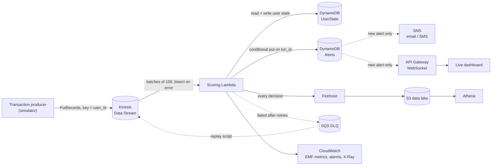

# Real-Time Fraud Detection Pipeline

Scores card transactions for fraud **as they stream in**, flags suspicious ones in well under a second, pushes them to a live dashboard and on-call alerts, and lands every decision in a queryable data lake. It is built on AWS (Kinesis, Lambda, DynamoDB, API Gateway WebSockets, SNS, Firehose, S3) and defined entirely in CDK.

| | |
|---|---|
| **Detection quality** (held-out data) | **94.0% precision · 87.5% recall** · 0.06% of legitimate transactions flagged |
| **Model** | Gradient-boosted trees, PR-AUC **0.938** (vs 0.802 for a logistic-regression baseline) |
| **Scoring cost** | **6,600+ txns/sec on one CPU core**, p99 **0.27 ms** per transaction |
| **Reliability** | Exactly-once alerts on an at-least-once stream, in-order retries, DLQ with replay |
| **Lambda dependencies** | **Zero** (model exported to JSON, inference in pure Python) |

> Run it on your laptop in one command with no AWS account: `python local/demo_server.py`, then open http://localhost:8000 and click **Inject an attack** to watch it get caught live.

---

## Architecture



**How one transaction is scored**

1. **Load state.** Fetch the user's profile from DynamoDB: recent timestamps, running mean and variance of spend (Welford's algorithm), last location, and known devices and countries. If this `txn_id` was already applied, skip it, because Kinesis redelivers records.
2. **Compute features** from the *prior* state: velocity in 1, 10 and 60 minute windows, amount z-score and ratio, travel speed since the last purchase (haversine), new device, new country, and merchant risk.
3. **Score.** The gradient-boosted model returns a fraud probability. Thresholds map it to `ALLOW`, `REVIEW` or `BLOCK`.
4. **Apply rules.** Config-driven rules attach human-readable reason codes. Rules that proved precise on held-out data can escalate a decision but never downgrade it.
5. **Run side effects**: alert record, SNS page, WebSocket push, and the Firehose record.
6. **Commit state last.** If anything above fails, a retry recomputes the identical decision.

---

## Results

All numbers come from a 600,000-transaction simulation with a **time-based** split: train on the first 70%, test on the last 30%. Full report: [`ml/report.md`](ml/report.md).

| Detector | Precision | Recall | F1 |
|---|---|---|---|
| Any rule fires (rules alone) | 0.242 | 0.663 | 0.355 |
| Logistic regression baseline | 0.323 | 0.955 | 0.483 |
| **Gradient-boosted trees + rule overrides (shipped)** | **0.940** | **0.875** | **0.906** |

| Fraud pattern | Recall |
|---|---|
| Account takeover | 99.5% |
| Impossible travel | 100% |
| Card testing | 85.4% |
| Amount spike | 72.6% |

Amount spikes are the hardest pattern because the simulator also generates genuine big purchases (a new TV, a trip) at 3–18× normal spend. That overlap is intentional.

Performance ([`loadtest/results.md`](loadtest/results.md)):

| Path | Throughput (1 core) | Latency |
|---|---|---|
| Core pipeline | 6,643 txns/s | p50 0.14 ms · p99 0.27 ms per txn |
| Lambda handler, batches of 100 (AWS calls faked) | 4,826 txns/s | p50 19 ms · p99 29 ms per batch |

---

## Design decisions & trade-offs

**Simulated data instead of a public dataset.** Public fraud datasets ship anonymized PCA features, so you can't do real-time feature engineering on them. The simulator models users with stable habits and injects four labeled attack patterns (card testing, impossible travel, amount spikes, account takeover). It also injects **legitimate behavior that looks suspicious**: real trips abroad, big one-off purchases, app-store micro-purchases, and new phones. My first version scored ROC-AUC 1.0, which only meant the fraud was too easy to spot. I made the attacks subtler until the metrics became believable.

**Gradient-boosted trees, exported to JSON.** GBM beat logistic regression on PR-AUC (0.938 vs 0.802). Shipping scikit-learn to Lambda would mean a large package and slow cold starts, so training exports the trees as arrays and inference is a short tree walk in pure Python. Training asserts the export matches sklearn's output to within 1e-3 before writing the model.

**Rules escalate; they don't vote.** I first blended rule scores into the risk score with a noisy-OR. Measured on held-out data, that *lowered* PR-AUC from 0.94 to 0.90, because broad rules like "3+ transactions in 10 minutes" fire on many legitimate users. Now every rule is a reason code, and only rules with measured precision above 98% (`impossible_travel`, `new_device_new_country`) may force a BLOCK. Ops can still add a blocking rule in config during an incident without retraining.

**PR-AUC, not ROC-AUC.** With about 1% fraud, ROC-AUC is above 0.99 for most models and hides false positives. Precision and recall are what a fraud team pays for.

**Exactly-once effects on an at-least-once stream.** Kinesis and Lambda can deliver a record more than once. Three mechanisms make retries safe:
- Per-user state keeps the last 64 `txn_id`s, so a redelivered record is skipped.
- Alerts use a DynamoDB conditional put on `txn_id`, so a retry can't create a second alert or page anyone twice.
- State is committed *last*, so a failure mid-way leaves no partial update.

**In-order retries.** Records are partitioned by `user_id`, so each user's events stay ordered. On failure the handler stops and reports the failed sequence number (`ReportBatchItemFailures`). Lambda resumes from exactly that record, which matters because velocity and travel features depend on order. `parallelization_factor=2` still preserves per-key ordering.

**Poison pills don't block the shard.** Malformed JSON is logged, counted (`Malformed` metric) and skipped. Real processing errors are retried, then bisected, then sent to the SQS DLQ. For Kinesis sources the DLQ only holds metadata (shard and sequence range), so [`scripts/replay_dlq.py`](scripts/replay_dlq.py) fetches the original records and re-drives them, which is safe because of the idempotency above.

**Blocked transactions don't teach the profile.** If a fraudster's first charge is blocked, their device and country are *not* added to the user's known list, so their second attempt still looks new. Velocity still counts every attempt.

**Optimistic locking on user state.** Each state write is conditional on the version read. A concurrent writer causes a `StaleStateError`, and the record is retried rather than silently overwritten.

**DynamoDB for state, not Redis.** ElastiCache needs a VPC, NAT and an always-on node. DynamoDB on-demand costs nothing when idle and is enough at this scale. At much higher volume I'd move hot sliding windows to Redis or to Flink's managed state.

**Cheap, honest observability.** Metrics are emitted with CloudWatch Embedded Metric Format (log lines, with no `PutMetricData` calls on the hot path). Alarms cover consumer lag (iterator age above 60 s) and DLQ depth, and X-Ray tracing is enabled.

---

## Project layout

```
src/fraud_pipeline/      # deployed to Lambda as-is (no third-party deps)
  simulator.py           #   users, legit noise, 4 labeled attack patterns
  features.py            #   streaming features + per-user state (Welford, windows)
  model.py               #   pure-Python GBM / logistic inference from JSON
  rules.py               #   config-driven rules engine (reason codes + overrides)
  pipeline.py            #   state -> features -> model + rules -> decision -> sinks
  state.py               #   in-memory and DynamoDB (optimistic locking) stores
  sinks.py               #   alerts (idempotent), SNS, WebSocket, Firehose, local
  aws/handler.py         #   Kinesis Lambda: ordering, partial failures, EMF metrics
  aws/ws.py              #   WebSocket $connect / $disconnect
  config/rules.json      #   rules, editable without code changes
  config/model.json      #   trained model + thresholds
ml/train.py              # simulate -> featurize -> train -> verify export -> report
local/demo_server.py     # whole pipeline + live dashboard, standard library only
dashboard/index.html     # live dashboard (SSE locally, WebSocket on AWS)
infra/                   # AWS CDK app (Python)
scripts/producer.py      # stream simulated traffic into Kinesis
scripts/replay_dlq.py    # re-drive failed records from the DLQ
loadtest/bench.py        # throughput / latency benchmark
tests/                   # 35 unit tests, AWS services faked in memory
docs/                    # Athena queries
```

---

## Run it locally (no AWS)

Requires Python 3.11+. The pipeline itself uses only the standard library.

```bash
python local/demo_server.py          # http://localhost:8000
python -m unittest discover -s tests # 35 tests, < 1 second
python loadtest/bench.py             # benchmark
```

Retraining the model needs numpy and scikit-learn:

```bash
pip install -r requirements-dev.txt
python ml/train.py                   # ~5 min; rewrites config/model.json and ml/report.md
```

## Deploy to AWS

Requires an AWS account, Node.js 18+ and the AWS CLI configured (`aws configure`).

```bash
npm install -g aws-cdk
cd infra
pip install -r requirements.txt
cdk bootstrap                                  # once per account/region
cdk deploy -c alertEmail=you@example.com       # confirm the SNS email subscription
```

The deploy prints `WebSocketUrl`, `StreamName` and `DlqUrl`. Then:

```bash
# stream traffic (from the repo root)
python scripts/producer.py --stream fraud-transactions --tps 50 --duration 300

# prove idempotency: re-send 5% of records, then check that the Duplicates metric rises but alerts don't double
python scripts/producer.py --tps 50 --duration 120 --duplicate-rate 0.05

# watch it live: serve the dashboard and point it at the WebSocket
python -m http.server 8080 --directory dashboard
# open http://localhost:8080/?ws=<WebSocketUrl>
```

The CloudWatch dashboard **fraud-pipeline** shows throughput, p50/p99 end-to-end latency, consumer lag, errors, duplicates and DLQ depth. Example Athena queries are in [`docs/athena.sql`](docs/athena.sql).

**Cost.** Everything is pay-per-request except one Kinesis shard (about $0.015/hour, roughly $11/month if left running). Set a billing alarm and tear down when you're done:

```bash
cdk destroy
```

## What I'd do next at real scale

- Move windowed features to **Managed Service for Apache Flink** for event-time windows and late-data handling.
- Use a **feature store** (SageMaker Feature Store) so offline training and online serving read the same features.
- Close the **feedback loop**: analyst verdicts and chargebacks become labels, with scheduled retraining and drift monitoring on feature distributions.
- **Shadow-deploy** new models (score with both, act on one) before switching over.
- Add a per-merchant and per-device **graph** to catch fraud rings that span many accounts.
