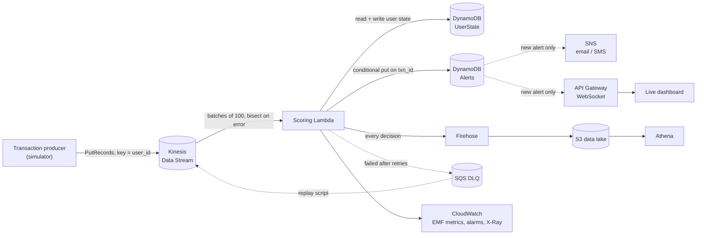

# Swipestop: Real-Time Fraud Detection You Can Talk To

[](https://github.com/akhilsripada/fraud-detection-pipeline/actions/workflows/ci.yml)
[](https://akhilsripada.github.io/fraud-detection-pipeline/)
[](LICENSE)

Swipestop scores card transactions for fraud **as they stream in**, blocks the suspicious ones in well under a millisecond, and **explains every decision in plain English**. Ask it *"why was u01037 blocked?"* on the dashboard, from Claude or ChatGPT through its MCP server, or watch attacks land on an **AR globe** on your desk.

When it blocks a purchase, the **cardholder** gets a *"Was this you?"* alert. It shows exactly where and when the purchase happened, including the store, its coordinates, and the local time there next to yours. Tap **Show me where** and the phone's camera puts a pin in the real direction of the store, using GPS and the compass. **"No, freeze my card"** blocks everything after it, and both answers are saved as labelled training data.

It runs two ways from the same code: on your laptop with one command, or serverless on AWS (Kinesis, Lambda, DynamoDB, API Gateway WebSockets, SNS, Firehose, S3), defined entirely in CDK.

**[Try the live demo](https://akhilsripada.github.io/fraud-detection-pipeline/)** (runs in your browser; ask *"why was the last transaction blocked?"* and open the cardholder alert) · **[AR globe](https://akhilsripada.github.io/fraud-detection-pipeline/ar/)**

| | |
|---|---|
| **Detection quality** (held-out data) | **94.0% precision · 87.5% recall** · 0.06% of legitimate transactions flagged |
| **Model** | Gradient-boosted trees, PR-AUC **0.938** (vs 0.802 for a logistic-regression baseline) |
| **Scoring cost** | **6,600+ txns/sec on one CPU core**, p99 **0.27 ms** per transaction |
| **Assistant** | Answers in **under 1 ms** for known questions; an optional LLM only routes free-form ones |
| **Reliability** | No duplicate alerts on an at-least-once stream, in-order retries, DLQ with replay |
| **Dependencies** | **None** to run it. Python 3.11+ standard library only |

## Run it in one command

```bash
git clone https://github.com/akhilsripada/fraud-detection-pipeline.git
cd fraud-detection-pipeline
python3 run.py        # on Windows: python run.py
```

Your browser opens http://localhost:8000, the same page as the live demo but connected to the real engine: the trained model, the live stream and the SQLite database. Press **Run an attack** and watch it land on the receipt tape, get declined, and get explained in the case file. Open the cardholder's alert from there. The ops metrics view (throughput, latency, live precision and recall) is at http://localhost:8000/console. With Docker instead: `docker compose up`.

**On your phone, or for someone else:** `python3 run.py --share` also prints a temporary `https://` link to the engine on your laptop. Open it on any phone, and the cardholder page's camera, compass and GPS "show me where" view works too, since phones only allow those on https. It uses a free Cloudflare quick tunnel if `cloudflared` is installed (`brew install cloudflared`), and otherwise [localhost.run](https://localhost.run) over the `ssh` that Mac, Linux and Windows already have. No account is needed. The link works only while it's running, so keep the laptop awake (macOS: `caffeinate -i python3 run.py --share`). If the provider drops the link, `run.py` opens a new one and prints it. Cloudflare's links are the more reliable of the two. Ctrl+C closes it.

## Talk to it

| Where | How |
|---|---|
| **Dashboard** | Type a question in **Ask Swipestop**, or click any alert to ask why it was flagged. |
| **Claude, ChatGPT, Cursor** | Add the MCP server (below), then ask *"what fraud happened in Europe today?"* |
| **HTTP API** | `curl -X POST localhost:8000/api/ask -d '{"text":"give me a summary"}'` |
| **AR** | Open `/ar` on an Android phone with Chrome, tap **Start AR**, and place the globe on a table. Run `python3 run.py --host 0.0.0.0` so your phone can reach your laptop. iPhone Safari doesn't support WebXR AR yet, so it shows the 3D globe instead. |

Questions it understands: *why was u01037 blocked?* · *why was the last transaction blocked?* · *simulate impossible travel* · *show me fraud in Asia* · *give me a summary* · *show all*. Set `GEMINI_API_KEY` (Google's free tier works) to also handle free-form questions like *"anything weird happening in the far east?"*.

**MCP setup (Claude Desktop):** add this to `claude_desktop_config.json`, with Swipestop running:

```json
{"mcpServers": {"swipestop": {"command": "python3", "args": ["/full/path/to/fraud-detection-pipeline/mcp/swipestop_mcp.py"]}}}
```

Tools: `ask_swipestop`, `recent_alerts`, `fraud_stats`, `simulate_attack`, `cardholder_alert`. Every answer ends with a link to the live dashboard.

## The cardholder's side: "Was this you?"

Every flagged row on the dashboard has a **card alert ↗** link (`/customer/<txn_id>`). That's the page the cardholder sees on their phone:

| | |
|---|---|
| **Where** | Store name, city and exact coordinates, plus a map of the card's last purchases with the path between them |
| **When** | Local time where the purchase happened (`Europe/London`, `Asia/Kolkata`...), your own time, and how long ago |
| **Why** | The rules that fired, in plain words, e.g. *"14,697 km from the purchase before, 25 min later (35,252 km/h, faster than any plane)"* |
| **Show me where** | Camera view with a pin over the real direction of the store. Bearing comes from GPS, facing comes from the compass (`webkitCompassHeading` on iPhone, `deviceorientationabsolute` on Android), and the pin's height follows the phone's tilt. Off-screen, it says which way to turn. On a laptop, drag to look around. |
| **Answer** | **Yes, it was me** records a false alarm (label 0). **No, freeze my card** records fraud (label 1) and blocks every later purchase on the card (`card_frozen`). Answers are idempotent and survive restarts (SQLite). |

```bash
curl localhost:8000/api/alerts/<txn_id>/context                               # where, when, the card's timeline
curl -X POST localhost:8000/api/alerts/<txn_id>/feedback -d '{"verdict":"not_mine"}'
curl localhost:8000/api/feedback                                              # answers as labelled examples
curl -X POST localhost:8000/api/cards/<user_id>/unfreeze
```

**Push to your phone (free):** install the [ntfy](https://ntfy.sh) app, subscribe to a topic name only you know, then run
`python3 run.py --host 0.0.0.0 --notify your-topic --public-url http://<laptop-ip>:8000`.
Each blocked purchase sends *"$812.40 in London, GB was blocked on your card. Was this you?"*, and tapping it opens the alert. Pushes are limited to one every 20 seconds.

> Phone browsers only allow the camera and compass on HTTPS pages, so for the AR view on a phone use the live demo, which is served over HTTPS. On the laptop itself, `localhost` works.

The answers close the loop. Precision measured from cardholder replies is the number a real fraud team watches, and the labelled rows from `/api/feedback` are exactly what a retraining job needs. Metrics on the dashboard still measure the model alone: a frozen card's blocks aren't counted as model hits.

---

## Architecture

Two deployments share one scoring core (`src/fraud_pipeline`). **Self-hosted:** `run.py` runs the pipeline, SQLite store, dashboard, assistant, HTTP API and MCP server on one machine. **AWS:** the same code runs in Lambda behind Kinesis:



**How one transaction is scored**

1. **Load state.** Fetch the user's profile from DynamoDB: recent timestamps, running mean and variance of spend (Welford's algorithm), last location, and known devices and countries. If this `txn_id` was already applied, skip it, because Kinesis redelivers records.
2. **Compute features** from the *prior* state: velocity in 1, 10 and 60 minute windows, amount z-score and ratio, travel speed since the last purchase (haversine), new device, new country, and merchant risk.
3. **Score.** The gradient-boosted model returns a fraud probability. Thresholds map it to `ALLOW`, `REVIEW` or `BLOCK`.
4. **Apply rules.** Config-driven rules attach human-readable reason codes. Rules that proved precise on held-out data can escalate a decision but never downgrade it.
5. **Run side effects**: alert record, SNS page, WebSocket push, and the Firehose record.
6. **Commit state last.** If anything above fails, a retry recomputes the identical decision.

---

## Results

All numbers come from a 600,000-transaction simulation with a **time-based** split: train on the first 70%, test on the last 30%. Full report: [`ml/report.md`](ml/report.md).

| Detector | Precision | Recall | F1 |
|---|---|---|---|
| Any rule fires (rules alone) | 0.242 | 0.663 | 0.355 |
| Logistic regression baseline | 0.323 | 0.955 | 0.483 |
| **Gradient-boosted trees + rule overrides (shipped)** | **0.940** | **0.875** | **0.906** |

| Fraud pattern | Recall |
|---|---|
| Account takeover | 99.5% |
| Impossible travel | 100% |
| Card testing | 85.4% |
| Amount spike | 72.6% |

Amount spikes are the hardest pattern because the simulator also generates genuine big purchases (a new TV, a trip) at 3–18× normal spend. That overlap is intentional.

Performance ([`loadtest/results.md`](loadtest/results.md)):

| Path | Throughput (1 core) | Latency |
|---|---|---|
| Core pipeline | 6,643 txns/s | p50 0.14 ms · p99 0.27 ms per txn |
| Lambda handler, batches of 100 (AWS calls faked) | 4,826 txns/s | p50 19 ms · p99 29 ms per batch |

---

## Design decisions & trade-offs

**The language model routes; the code answers.** Every explanation is assembled from the decision's own features (distance, speed, spend ratio, device history), so it can't contain a number the model didn't compute. Fast rules handle the common questions in under a millisecond for free. Only when they don't match, and a key is configured, is an LLM asked to pick one of the same fixed intents; its output is validated against an allow-list, cached, and any failure falls back gracefully. An LLM can therefore never invent a fact about a customer's transaction, and the dashboard keeps working when the LLM is down or out of quota.

**SQLite for the self-hosted version.** Alerts persist across restarts with the same idempotency rule as DynamoDB (the transaction id is the primary key), counters are written once per second instead of once per transaction, and there's nothing to install. The store has a four-method interface, so swapping in PostgreSQL is a one-file change.

**Simulated data instead of a public dataset.** Public fraud datasets ship anonymized PCA features, so you can't do real-time feature engineering on them. The simulator models users with stable habits and injects four labeled attack patterns (card testing, impossible travel, amount spikes, account takeover). It also injects **legitimate behavior that looks suspicious**: real trips abroad, big one-off purchases, app-store micro-purchases, and new phones. My first version scored ROC-AUC 1.0, which only meant the fraud was too easy to spot. I made the attacks subtler until the metrics became believable.

**Gradient-boosted trees, exported to JSON.** GBM beat logistic regression on PR-AUC (0.938 vs 0.802). Shipping scikit-learn to Lambda would mean a large package and slow cold starts, so training exports the trees as arrays and inference is a short tree walk in pure Python. Training asserts the export matches sklearn's output to within 1e-3 before writing the model.

**Rules escalate; they don't vote.** I first blended rule scores into the risk score with a noisy-OR. Measured on held-out data, that *lowered* PR-AUC from 0.94 to 0.90, because broad rules like "3+ transactions in 10 minutes" fire on many legitimate users. Now every rule is a reason code, and only rules with measured precision above 98% (`impossible_travel`, `new_device_new_country`) may force a BLOCK. Ops can still add a blocking rule in config during an incident without retraining.

**PR-AUC, not ROC-AUC.** With about 1% fraud, ROC-AUC is above 0.99 for most models and hides false positives. Precision and recall are what a fraud team pays for.

**Duplicate-free effects on an at-least-once stream.** Kinesis and Lambda can deliver a record more than once. Three mechanisms make retries safe:
- Per-user state keeps the last 64 `txn_id`s, so a redelivered record is skipped.
- Alerts use a DynamoDB conditional put on `txn_id`, so a retry can't create a second alert or page anyone twice.
- State is committed *last*, so a failure mid-way leaves no partial update.

**In-order retries.** Records are partitioned by `user_id`, so each user's events stay ordered. On failure the handler stops and reports the failed sequence number (`ReportBatchItemFailures`). Lambda resumes from exactly that record, which matters because velocity and travel features depend on order. `parallelization_factor=2` still preserves per-key ordering.

**Poison pills don't block the shard.** Malformed JSON is logged, counted (`Malformed` metric) and skipped. Real processing errors are retried, then bisected, then sent to the SQS DLQ. For Kinesis sources the DLQ only holds metadata (shard and sequence range), so [`scripts/replay_dlq.py`](scripts/replay_dlq.py) fetches the original records and re-drives them, which is safe because of the idempotency above.

**Blocked transactions don't teach the profile.** If a fraudster's first charge is blocked, their device and country are *not* added to the user's known list, so their second attempt still looks new. Velocity still counts every attempt.

**Optimistic locking on user state.** Each state write is conditional on the version read. A concurrent writer causes a `StaleStateError`, and the record is retried rather than silently overwritten.

**DynamoDB for state, not Redis.** ElastiCache needs a VPC, NAT and an always-on node. DynamoDB on-demand costs nothing when idle and is enough at this scale. At much higher volume I'd move hot sliding windows to Redis or to Flink's managed state.

**Cheap, honest observability.** Metrics are emitted with CloudWatch Embedded Metric Format (log lines, with no `PutMetricData` calls on the hot path). Alarms cover consumer lag (iterator age above 60 s) and DLQ depth, and X-Ray tracing is enabled.

---

## Project layout

```
src/fraud_pipeline/      # deployed to Lambda as-is (no third-party deps)
  simulator.py           #   users, legit noise, 4 labeled attack patterns
  features.py            #   streaming features + per-user state (Welford, windows)
  model.py               #   pure-Python GBM / logistic inference from JSON
  rules.py               #   config-driven rules engine (reason codes + overrides)
  pipeline.py            #   state -> features -> model + rules -> decision -> sinks
  state.py               #   in-memory and DynamoDB (optimistic locking) stores
  sinks.py               #   alerts (idempotent), SNS, WebSocket, Firehose, local
  aws/handler.py         #   Kinesis Lambda: ordering, partial failures, EMF metrics
  aws/ws.py              #   WebSocket $connect / $disconnect
  config/rules.json      #   rules, editable without code changes
  config/model.json      #   trained model + thresholds
  assistant.py           #   plain-English questions -> intents -> answers from real features
  store.py               #   SQLite alert store for the self-hosted version
  customer.py            #   cardholder side: timeline, local time, answers, card freeze, ntfy push
ml/train.py              # simulate -> featurize -> train -> verify export -> report
run.py                   # one-command start: server + dashboard + browser
local/demo_server.py     # pipeline, dashboard, assistant and HTTP API, standard library only
local/tunnel.py          # --share: temporary https link via cloudflared or ssh (localhost.run)
dashboard/index.html     # ops metrics console at /console (SSE locally, WebSocket on AWS)
dashboard/customer.html  # cardholder alert: "was this you?", map, camera + compass "show me where"
mcp/swipestop_mcp.py      # MCP server so AI assistants can query the live stream
ar/index.html            # three.js globe with WebXR placement on real surfaces
site/index.html          # product page: live data at localhost:8000, in-browser simulation on GitHub Pages
infra/                   # AWS CDK app (Python)
scripts/producer.py      # stream simulated traffic into Kinesis
scripts/replay_dlq.py    # re-drive failed records from the DLQ
loadtest/bench.py        # throughput / latency benchmark
tests/                   # 70 tests: unit, AWS fakes, live server + MCP end to end
docs/                    # Athena queries
```

---

## Development

Requires Python 3.11+. The pipeline itself uses only the standard library.

```bash
python3 run.py                       # http://localhost:8000
python -m unittest discover -s tests # 70 tests, a few seconds
python loadtest/bench.py             # benchmark
```

Retraining the model needs numpy and scikit-learn:

```bash
pip install -r requirements-dev.txt
python ml/train.py                   # ~5 min; rewrites config/model.json and ml/report.md
```

## Deploy to AWS

Requires an AWS account, Node.js 18+ and the AWS CLI configured (`aws configure`).

```bash
npm install -g aws-cdk
cd infra
pip install -r requirements.txt
cdk bootstrap                                  # once per account/region
cdk deploy -c alertEmail=you@example.com       # confirm the SNS email subscription
```

The deploy prints `WebSocketUrl`, `StreamName` and `DlqUrl`. Then:

```bash
# stream traffic (from the repo root)
python scripts/producer.py --stream fraud-transactions --tps 50 --duration 300

# prove idempotency: re-send 5% of records, then check that the Duplicates metric rises but alerts don't double
python scripts/producer.py --tps 50 --duration 120 --duplicate-rate 0.05

# watch it live: serve the dashboard and point it at the WebSocket
python -m http.server 8080 --directory dashboard
# open http://localhost:8080/?ws=<WebSocketUrl>
```

The CloudWatch dashboard **fraud-pipeline** shows throughput, p50/p99 end-to-end latency, consumer lag, errors, duplicates and DLQ depth. Example Athena queries are in [`docs/athena.sql`](docs/athena.sql).

**Cost.** Everything is pay-per-request except one Kinesis shard (about $0.015/hour, roughly $11/month if left running). Set a billing alarm and tear down when you're done:

```bash
cdk destroy
```

## What I'd do next at real scale

- Move windowed features to **Managed Service for Apache Flink** for event-time windows and late-data handling.
- Use a **feature store** (SageMaker Feature Store) so offline training and online serving read the same features.
- Close the **feedback loop**: analyst verdicts and chargebacks become labels, with scheduled retraining and drift monitoring on feature distributions.
- **Shadow-deploy** new models (score with both, act on one) before switching over.
- Add a per-merchant and per-device **graph** to catch fraud rings that span many accounts.
